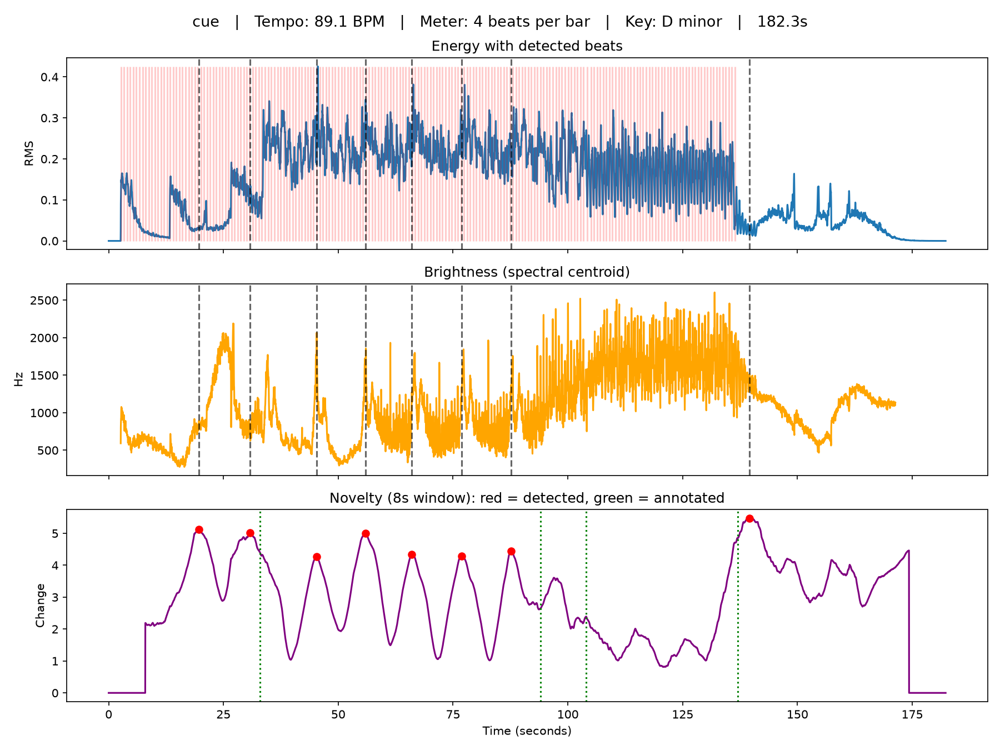

# Film Score Analyzer

A Python tool that analyzes a film score cue and produces a visual
report of its tempo, meter, key, energy, brightness, and section
structure, the information a composer or music editor works out by
ear in a spotting session.

Built by Gautam Vedula, film composer (NYU Steinhardt, BM Screen
Scoring), and validated against cues from my own scoring sessions.

## Why

After scoring 70+ film and media projects, I wanted to know how much
of a spotting session analysis a computer can reproduce from audio
alone, and where it breaks down on real film music. Each feature was
checked against the original DAW session for the cue, not against
memory.

## What it measures

- **Tempo and beats** using librosa's beat tracker
- **Meter** (3 vs 4 beats per bar), estimated by combining onset
  strength and harmonic change on each beat and testing which grouping
  makes downbeats stand out most
- **Key and mode** by matching the cue's averaged chroma against the
  Krumhansl-Kessler key profiles
- **Energy** (RMS) over time
- **Brightness** (spectral centroid) over time, masked wherever energy
  falls below 2% of the maximum so silence doesn't produce false
  readings
- **Section boundaries** using novelty detection: at each moment, it
  compares the average harmony (chroma) and timbre (MFCC) of the
  8 seconds before to the 8 seconds after, and reports the largest
  changes

## Setup

    python3 -m venv venv
    source venv/bin/activate
    pip install -r requirements.txt

## Usage

    python analyzer.py <audio file> [annotated boundary times in seconds]

Example:

    python analyzer.py cue.wav 33 94 137

This saves `cue_analysis.png` (a three panel graph) and
`cue_report.txt`. If boundary times are given, it scores the detected
boundaries against them using the standard 3 second tolerance from
music structure research.

## Validation

Tested on three of my own cues. Answer keys come from the DAW session,
using a written annotation rule (see `notes.md`).

| Cue | Style | Tempo (true / detected) | Key | Boundaries found |
|---|---|---|---|---|
| 1 | Synth and orchestral, D minor | 90 / 89.1 | Correct | 2 of 3 |
| 2 | Slow, C major | 60 / 123 | Correct | 3 of 5 |
| 3 | Tabla driven, B♭ major | 80 / 107.7 | Correct | 4 of 4 |

**Total: 9 of 12 boundaries within 3 seconds. Key correct on all
three cues.**

## What I learned

- **The tool detected phrase structure it was never told about.** With
  a 4 second window, the novelty peaks in cue 1 landed almost exactly
  4 bars apart, matching the phrase changes in the score. A longer
  window shifted it toward section boundaries.
- **The beat tracker correctly found where the pulse ends.** In cue 1
  it stopped detecting beats exactly where the cue drops into an
  unmetered tail.
- **Tempo errors follow simple ratios.** Cue 2 was doubled (60 to 123).
  Cue 3 came out at roughly 4:3 of the true tempo because the beat
  tracker, built around Western pulse conventions, locked onto
  subdivisions in a tabla pattern.
- **The 89.1 vs 90 BPM difference is frame resolution, not error.**
  At a 512 sample hop and 22050 Hz, no whole number of frames per
  beat equals exactly 90 BPM.

## Limitations

- Rhythm isn't part of the structure features, so changes that are
  mostly rhythmic (like a beat drop) barely register
- The 8 second window can't detect boundaries in the first or last
  8 seconds, or two boundaries closer than 8 seconds apart
- Parameters were first tuned on one cue and tested on only three
- Tempo and meter estimation assume Western pulse conventions
- Meter testing only separates 3 from 4, and can't determine the
  bottom number of a time signature

## Next steps

- Add a rhythm feature so beat drops and groove changes register
- Scale the novelty window to the length and tempo of the cue
- Test on a larger and more stylistically diverse set of cues

Audio files are not included in this repository.